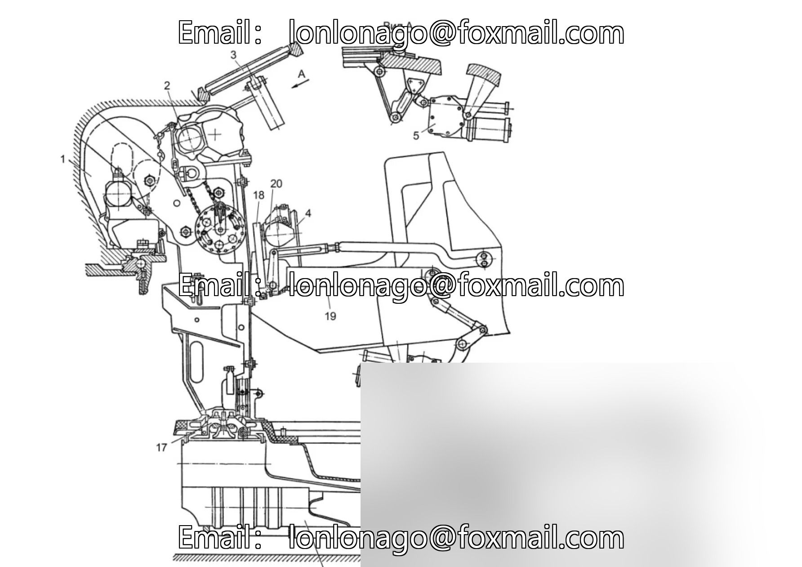
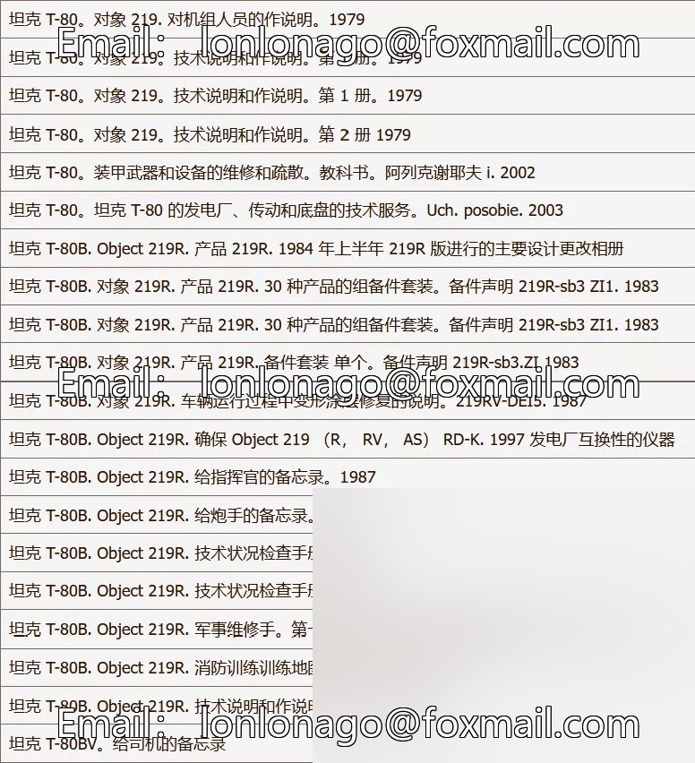
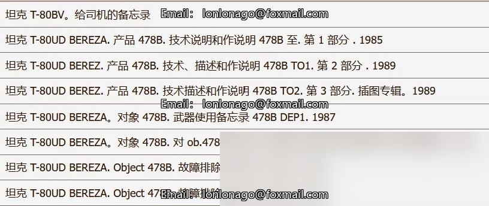
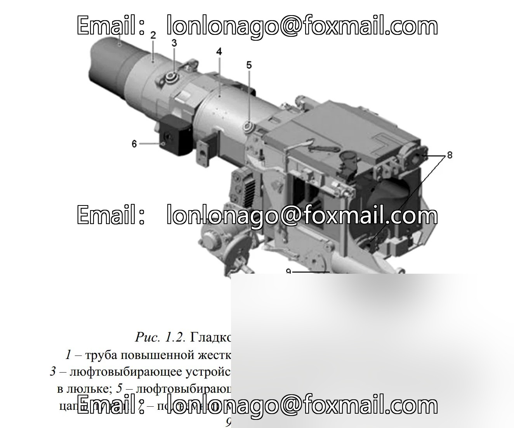

# Soviet/Russian T-80 series main combat tank (including T-80B/T-80BV)

## Body

The complete technical documentation system for the Soviet/Russian T-80 series main battle tank (including models such as T-80B, T-80BV, and T-80UD) is approximately 27 volumes.
Main information is as follows:
1. Characteristics of the documentation system

Model coverage:

Baseline: T-80 (Object 219, 1979)

Improved type: T-80B (Object 219R, 1983-1987), T-80BV, T-80UD BEREZA (Object 478B, 1985-1990)

Special versions: 219R, 219RV, 219AS and other derived model numbers

Document type:

Earliest document: 1979 (T-80 basic model)

2. Key model technical differences

T-80UD BEREZA (478B Project):

Exclusive document: Weapon usage memo (478B DEP1), 902B special recommendations for fire control system (1990)

Technical volume: technical instructions are in three volumes (1985-1989), including illustrations album.

T-80B (219R Project):

Design changes: 1984 year photo album records main improvements

Parts management: 30-group spare part sets declaration (219R-sb3 ZI1, 1983)

Warranty standards: The military maintenance manual of 1984 explicitly specifies the unit replacement procedure.

3. Special technical points

Fire control system:

T-80UD is equipped with the 902B fire control complex (1990 recommended document)

T-80B ensures the interchangeability of the power plant through the 219R-DEI5 specification (1997)

Maintenance system

Layered repair: from quick fault exclusion (1990 manual) to deep component replacement (1984 military manual)

Wartime repair: containing deformation coating repair technology (1987)

## Images

## Payment

Here is a pay link on Stripe ( https://buy.stripe.com/3cs8yP7sY87d0vu9AB ). Please contact me lonlonago@foxmail.com after funding $89, and I will send you a complete data files , thank you!

